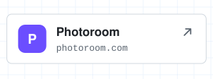
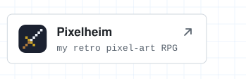

<picture><source media="(prefers-color-scheme: dark)" srcset="assets/profile-dark.svg"></picture>

<a href="https://www.linkedin.com/in/tom-k-11a617134/"><picture><source media="(prefers-color-scheme: dark)" srcset="assets/link-linkedin-dark.svg"></picture></a><a href="https://www.photoroom.com"><picture><source media="(prefers-color-scheme: dark)" srcset="assets/link-photoroom-dark.svg"></picture></a><a href="https://github.com/TomKlotzPro/pixelheim"><picture><source media="(prefers-color-scheme: dark)" srcset="assets/link-pixelheim-dark.svg"></picture></a>

